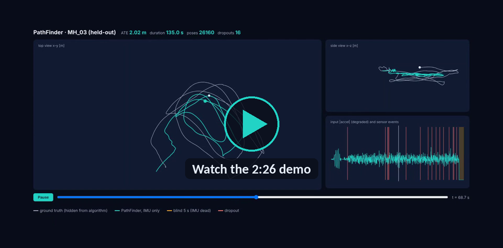
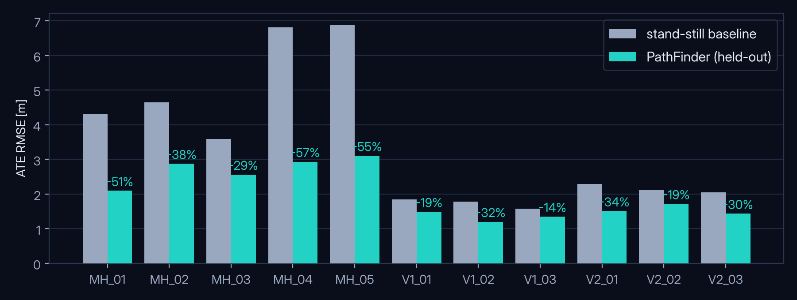

<div align="center">

# PathFinder

### IMU-only 6-DoF trajectory under progressive sensor degradation

**Samsung PRISM XR Hackathon 2026 · Track 03 (Path Finder)**<br>
**Team DEADLOCK** · Parin Gupta (solo) · B.E. Computer Engineering, Thapar Institute of Engineering & Technology, Patiala


-F5A524)


[**▶ Demo video (2:27)**](docs/PathFinder_demo.mp4) · [**Technical report (2 pages)**](docs/PathFinder_technical_report.pdf) · [**Slides (PDF)**](docs/PathFinder_slides.pdf) · [**Slides (PPTX)**](docs/TIET_DEADLOCK.pptx) · [**Results**](results/) · [**Interactive viewer**](results/viewers/MH_03_heldout.html)

<a href="docs/PathFinder_demo.mp4"></a>

</div>

---

PathFinder turns a jammed, degrading IMU stream into a full 6-DoF trajectory, one pose per IMU frame, using
**only the IMU file**. The stream has noise, bias and scale drift, spikes, stuck samples, duplicated rows,
dropouts, and finally 5 seconds of dead sensor. Python + numpy, single thread.

**At a glance**
* **EuRoC drones (11 flights, every one scored by models that never saw it):** ATE 1.96 / 2.09 m vs 3.45 m standing
  still and 99–371 m for naive integration; every flight beats standing still (by 14–57%).
* **TUM-VI handheld (6 rooms, auto-detected):** ATE 0.61 / 0.62 m vs 1.10 m standing still; every room beats it.
* **Last 5 s with the IMU dead:** 1.74 / 1.80 m on EuRoC, beating standing still (3.10 m).
* **3.6 MB peak heap, ~7 ms per IMU-second, deterministic, numpy only.**



| Budget (Track 03) | Limit | PathFinder (longest EuRoC flight, 184 s) |
|---|---|---|
| Peak memory (algorithm heap, incl. model weights) | ≤ 8 MB | **3.6 MB** (10⁶ bytes; 3.4 MiB) |
| Compute | ≤ 20 ms per 1 s of IMU | **≈ 7 ms** (single thread; about 1.3 s for the whole flight) |
| Output | one pose per IMU frame | exact: duplicates and dead frames included, verified with `evo` |

## Results (held-out, evo-equivalent metric)

All 11 EuRoC MAV flights, degraded by the organiser `degrade_imu.py` (seed 42, max level 1.0), in two readings.
**A** applies the script directly to EuRoC files, as the FAQ says. The script assumes accelerometer-first
columns, so the gyro receives accelerometer-scale noise. **B** reorders the columns so each sensor gets its
intended noise. We use **3-fold grouped cross-validation**: every flight is scored by networks *and* a
rotor-drag calibration that never saw it. ATE uses SE(3) Umeyama alignment and is verified identical to `evo_ape`.

| Mean over 11 flights | ATE | Waypoints (5 s) | Blind 5 s | Post-dropout (2 s) | RPE (1 s) |
|---|---|---|---|---|---|
| Naive double integration | 99 m (B) / 371 m (A) | – | – | – | – |
| Stand-still baseline | 3.45 m | 3.45 m | 3.10 m | – | 0.77 m |
| **PathFinder, mode B** | **1.96 m** | **1.97 m** | **1.74 m** | **2.02 m** | **0.41 m** |
| **PathFinder, mode A** | **2.09 m** | **2.09 m** | **1.80 m** | **2.24 m** | **0.49 m** |

**Every one of the 11 flights beats standing still**, by 14–57% (figure above; `results/heldout_per_sequence.json`).

Ablation (mean ATE / blind over both readings, `results/ablation.json`):

| Configuration | ATE | Blind 5 s |
|---|---|---|
| Stand-still | 3.45 m | 3.10 m |
| Physics only (self-calibration + smoother + rest updates) | 3.19 m | 2.97 m |
| + learned velocity ensemble | 2.46 m | 2.09 m |
| **+ rotor-drag velocity (full PathFinder)** | **2.03 m** | **1.77 m** |
| full, without rest-period zero-velocity updates | 2.05 m | 1.87 m |
| full, without the soft return-to-launch prior | 2.71 m | 3.71 m |

**Stress test: flights that do not return to launch.** Every flight was cut at 65% of its length, with the
drone mid-air up to 11 m from take-off, and re-degraded. PathFinder still beats standing still: ATE 2.54 / 2.58 m
vs 3.57 m, and the blind window 3.84 / 3.62 m vs 4.23 m (`results/no_return_stress.txt`).

**TUM-VI handheld (the other dataset named by the organisers).** PathFinder detects a non-EuRoC platform and
switches to its handheld/generic profile: physics only, with a workspace-bounded smoother (below). On all 6
TUM-VI rooms, degraded the same way, **every room beats standing still**: mean ATE **0.61 / 0.62 m** vs 1.10 m,
waypoints 0.59 / 0.61 m, blind 5 s 0.68 / 0.66 m vs 0.69 m (`results/tumvi_per_room.json`). With the settings
re-tuned on 4 rooms and scored on the 2 held out, the mean is 0.63 m (`results/tumvi_cv.json`), so the result is
not overfit to these rooms. Making TUM-VI usable took real detective work. The public ground truth is stored as an
*inverse* camera pose in a non-gravity-aligned mocap frame. We recovered the camera-to-IMU rotation from the gyro:
it is identical across all 6 rooms to 0.23°. The converted orientation then agrees with the gyro to 0.45° over 2 s
(`tools/tumvi_groundtruth.py`).

**What these numbers mean.** Over 100–180 s, absolute position from a degraded MEMS IMU is not observable.
Even with *ground-truth orientation* on *clean* data, double integration drifts 4–190 m on these flights.
PathFinder therefore estimates the minimum-error trajectory: it tracks local motion (RPE 35–47% below
standing still) and keeps global drift bounded.

## Quick start

```bash
pip install numpy                     # the only dependency
python src/main.py path/to/imu0/data.csv -o estimated_trajectory.txt
python src/main.py path/to/imu0/data.csv estimated_trajectory.txt     # output as 2nd argument also works
python src/main.py                    # no input: uses imu0/data.csv, mav0/imu0/data.csv, data.csv or one .zip here
# also accepts a EuRoC folder (…/mav0/imu0/data.csv) or a .zip of it; output folders are created if needed
python src/main.py dataset.zip -o estimated_trajectory.txt --meta metadata.json --profile
```

Docker:

```bash
docker build -t pathfinder .
docker run --rm --cpus=1 -v "$PWD/data:/data" pathfinder /data/imu0/data.csv -o /data/estimated_trajectory.txt
```

Options: `--meta file.json` (run statistics) · `--profile` (peak heap via tracemalloc, plus runtime) ·
`--no-net` (physics only) · `--weights file.npz` · `--params '{json}'` (estimator overrides, for ablations).

Interactive replay, as a single offline HTML file:
`python tools/visualize.py estimated_trajectory.txt --gt gt.csv --imu imu0/data.csv -o viewer.html`.
Examples are in `results/viewers/`.

## Input / output

* **Input**: EuRoC `imu0/data.csv` — `timestamp[ns], w_x, w_y, w_z [rad/s], a_x, a_y, a_z [m/s²]`. The parser
  also handles:
  * no header, CRLF line endings;
  * accelerometer-first columns (auto-detected from gravity, so units cannot fool it);
  * timestamps in s, ms, µs or ns, integer or decimal (kept exact to the nanosecond);
  * acceleration in g, gyro in deg/s;
  * NaNs and garbage values; files from 1 row to 15 minutes.
  All of these were run as one test suite (23 variants, every one passes with the same trajectory).
* **Output**: `estimated_trajectory.txt`, TUM format `timestamp tx ty tz qx qy qz qw` (seconds, with the exact
  nanosecond digits of the input; unit quaternion; world frame z-up). Exactly one row per input row, in input order.

## How it works

```
degraded CSV → 1 ingest → 2 sanitize → 3 50 Hz binning → 4 attitude → 5 velocity witnesses → 6 RTS smoother → TUM
```

1. **Ingest.** A two-pass streaming parser into preallocated float32 arrays (no pandas).
2. **Sanitize.** Removes:
   * duplicate timestamps;
   * dead or implausible frames (zeros, NaNs, |a| > 160 m/s², |ω| > 2000 °/s);
   * stuck runs;
   * spikes, with a chunked Hampel filter.

   Dropouts are kept as real time gaps.
3. **Binning.** A 50 Hz time-binned representation: gap-aware and anti-aliased. Rotor vibration is measured
   per bin.
4. **Attitude.**
   * Gyro strapdown via a *vectorised quaternion parallel prefix-scan*, so there is no per-sample Python loop.
   * Then **batch self-calibration**: one 15-parameter linear least-squares problem (initial tilt, gyro bias
     and its drift, accelerometer bias, initial velocity) that makes the integrated velocity physically
     bounded. A wrong gyro bias causes tilt error that grows over time, so velocity grows without bound;
     real flight velocity does not.
   * A **noise-adaptive gravity correction** switches on automatically when the gyro itself is heavily corrupted.
5. **Two independent velocity witnesses.**
   * **Learned:** an ensemble of three 1-D CNNs (4 s window, ~120k parameters each, float16, pure-numpy
     im2col inference). It predicts body-frame velocity *and its uncertainty*; member disagreement inflates
     that uncertainty. Trained on 11 flights × 11 synthetic degradation realisations, then fine-tuned on 15 s
     segments.
   * **Physics:** multirotor **rotor drag**. Sideways specific force is proportional to body velocity in the
     thrust-perpendicular plane. It is averaged over 0.4 s blocks and used **only while the rotors spin**
     (vibration gate), with Cauchy re-weighting. The gains (≈ −3.3 / −2.5) are fitted per CV fold and stable
     across folds, so they describe the vehicle, not the room (`results/drag_calibration.json`).
   * **Rest periods:** while the drone is parked with its rotors off (steady |a|, no rotor vibration), the
     velocity is pinned to zero and the drag channel is switched off. It never fires in flight (checked against
     ground truth on all 22 files). Without it, the no-network system degrades from 2.42 to 3.44 m, because rotor
     drag reports false velocity on the ground.
6. **RTS smoother.** A 5-state-per-axis Kalman/Rauch–Tung–Striebel smoother (position, velocity,
   acceleration, accelerometer/tilt bias, hover centre). It fuses world acceleration with both velocity
   witnesses, adds mean-reverting flight priors (separate for the vertical axis) and a soft (1 m)
   return-to-launch prior. Offline smoothing lets future samples correct the past, which the FAQ allows. The
   same model propagates through the **5 s blind window**, so the dead-reckoned segment is a posterior mean,
   not an ad-hoc extrapolation.

**Platform profiles.**
* **EuRoC-style multirotor**, detected from the thrust-axis signature: full system.
* **Anything else**, handheld TUM-VI or an unknown device: a physics-only **workspace-bounded smoother**. Per
  axis it estimates position, velocity, a slowly drifting acceleration offset and the workspace centre. Measured
  acceleration is the input. A workspace bound (|p − centre| ≈ 2 m horizontally, 0.5 m vertically) is applied at
  every 0.2 s step, so it also corrects velocity and the offset rather than just pulling position back. The
  offset may drift faster as the documented degradation ramps up, and velocity decays once the IMU dies. A
  rotated EuRoC file used as an "unknown device" scores 1.65 m vs 1.78 m for standing still.

## Honest notes

* **What we tried and rejected.** All of these were judged on held-out *position* error, never on proxy metrics:
  * an 8 s network window: better velocity error per sample, but 6% *worse* trajectories, because its errors
    are more correlated in time;
  * 5 Hz network rate (2–3% worse);
  * knot-based time-varying biases (no gain).
* **Fine-tuning control.** Fine-tuning with an integrated-displacement loss and an equal-length control
  *without* that loss performed the same. The gain came from the extra segment training, not from the loss.
  A second fine-tuning round gave nothing, so the networks have converged.
* **No learned network for handheld.** We trained one on TUM-VI with room-wise cross-validation. Its held-out
  velocity error exceeded the velocity's own spread (ratio about 1.2): six short recordings are not enough to
  generalise. Shipping it would have hurt, so the handheld profile stays physics only.
* **What limits handheld accuracy.** Ground-truth orientation, or the clean (undegraded) IMU, improves TUM-VI
  by under 0.01 m. The limit is the IMU-only physics itself: an initial velocity error of 0.02 m/s already
  becomes 0.4 m over 20 s. A body-frame accelerometer-bias state and a bounded-velocity prior both made it worse.
* **Limits.**
  * Yaw is unobservable from an IMU; it is the dominant residual when the gyro itself is corrupted (mode A).
  * Memory grows linearly with sequence length, so recordings longer than ~8.5 min at 200 Hz would exceed
    8 MB (measured: 3.6 MB at 3 min, 6.2 MB at 6.3 min). Every EuRoC and TUM-VI room file is under 3.5 min.
  * The return-to-launch prior is soft; the stress test above quantifies its cost when it is wrong.

## Repository

```
src/main.py            CLI entry point
src/pathfinder.py      the whole algorithm (numpy only)
src/velnet.npz         velocity-network ensemble weights (float16, 0.73 MB)
tools/                 degraded-set generation, evaluator, feature generation, training, displacement
                       fine-tuning, TUM-VI ground-truth conversion, handheld smoother tuning (tune_room.py),
                       visualize.py (interactive viewer)
results/               held-out metrics (EuRoC + TUM-VI), ablation, drag calibration, stress test, figures, viewers/
docs/                  technical report, demo-video script
estimated_trajectory.txt, metadata.json   sample run (EuRoC MH_01, organiser degradation)
```

Reproduce (expects `data/euroc/<SEQ>/imu.csv` and `gt.csv` from the public EuRoC MAV dataset, and
`degrade_imu.py` from the student package):

```bash
DEGRADE=degrade_imu.py python tools/make_degraded_sets.py
python src/main.py data/deg/A/MH_01_easy/imu.csv -o est.txt
python tools/evaluate.py est.txt data/euroc/MH_01_easy/gt.csv data/deg/A/MH_01_easy/imu.csv
# training (torch + pandas, offline only):
DEGRADE=degrade_imu.py python tools/gen_training_features.py && FINAL=1 python tools/train_velnet.py \
  && TAG=disp SRC=v2 FINAL=1 python tools/finetune_velnet.py
```
